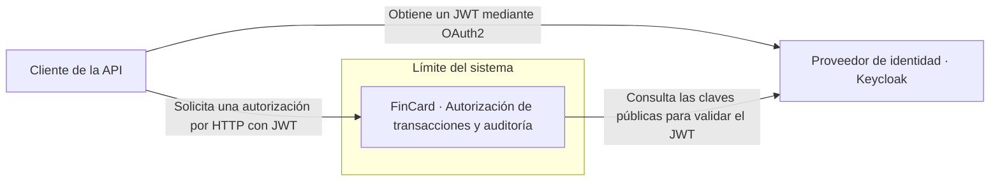

# C4 nivel 1 · Contexto del sistema

El diagrama sitúa a FinCard entre el consumidor de la API y el proveedor de identidad.

El cliente representa cualquier consumidor autorizado de la API. Envía el identificador de la tarjeta, el importe y un identificador de solicitud, y recibe el resultado de la autorización. FinCard registra la decisión y audita de forma asíncrona las transacciones aprobadas.

Keycloak queda fuera de la frontera funcional de FinCard como proveedor de identidad, aunque se despliega con el mismo archivo Compose. El cliente dispone de un JWT emitido por el realm `fincard`.
