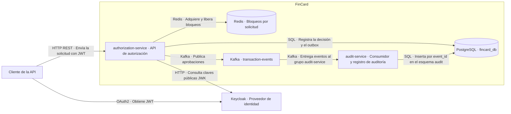

# C4 nivel 2 · Contenedores

| Contenedor | Tecnología y responsabilidad |
| --- | --- |
| `authorization-service` | Java 21, Spring Boot MVC y Spring Security. Expone `POST /api/transactions/authorize` en el puerto `8080`, procesa la autorización y publica los eventos pendientes. |
| `audit-service` | Java 21, Spring Boot, Spring Kafka y Spring Data JPA. Consume aprobaciones y guarda el registro de auditoría. |
| PostgreSQL | PostgreSQL 17 y Flyway. `fincard_db` contiene las tablas de autorización y el outbox en `public`, y `audit.transaction_audit` en el esquema `audit`. |
| Redis | Redis 7. Mantiene un bloqueo temporal por `requestId` para coordinar solicitudes simultáneas. |
| Kafka | Apache Kafka. Transporta eventos de aprobación en `transaction-events`. Los servicios usan `kafka:9093` en la red de Compose. |
| Keycloak | Proveedor OAuth2 del realm `fincard`. El emisor esperado es `http://localhost:8081/realms/fincard`; autorización consulta las claves mediante `keycloak:8080` dentro de Compose. |

Autorización valida el JWT y usa Redis para coordinar las solicitudes por `requestId`. PostgreSQL mantiene la protección definitiva mediante un índice único y confirma el débito, la decisión y el evento de aprobación pendiente en la misma transacción.

Después del commit, el publicador lee el outbox y envía el evento a Kafka. Auditoría consume el mensaje, confirma la inserción en PostgreSQL y permite confirmar el offset. Una nueva entrega con el mismo `eventId` conserva una sola fila.

Las flechas describen comunicación en ejecución. Las dependencias `depends_on` del archivo [docker-compose.yml](../../docker-compose.yml) ordenan el arranque y no representan llamadas de negocio.
