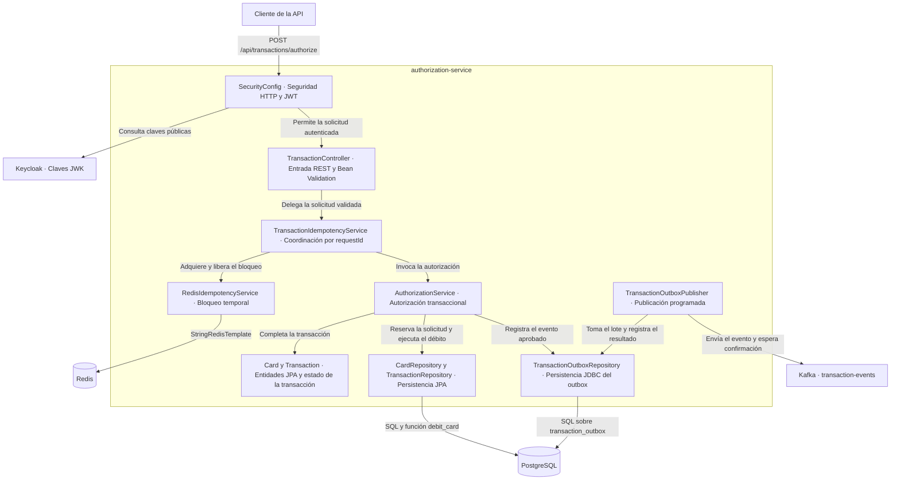

# C4 nivel 3 · Componentes de autorización

1. `SecurityConfig` protege el endpoint con JWT. Spring MVC valida el JSON de `AuthorizeTransactionRequest` antes de que `TransactionController` delegue al servicio de idempotencia.
2. `TransactionIdempotencyService` coordina el bloqueo temporal en Redis. Si Redis falla al adquirirlo, delega a PostgreSQL. Si otra solicitud mantiene el bloqueo, devuelve `REQUEST_PENDING`.
3. `AuthorizationService` consulta o reserva el `requestId` en una transacción. Si ya existe una solicitud con los mismos datos, devuelve el resultado registrado. Para una solicitud nueva, `CardRepository` invoca `debit_card`, que comprueba el estado, el vencimiento y el saldo. La entidad `Transaction` registra `APPROVED` o `DECLINED`.
4. Si la decisión es `APPROVED`, `AuthorizationService` guarda un `TransactionEvent` con el débito y la decisión en el mismo commit. El publicador programado toma eventos confirmados con `FOR UPDATE SKIP LOCKED` y marca la publicación después de la confirmación de Kafka. Si falla el envío, programa un reintento.

## Archivos de referencia

- HTTP y validación · `authorization-service/src/main/java/com/fincard/authorization/api/TransactionController.java` y `authorization-service/src/main/java/com/fincard/authorization/api/AuthorizeTransactionRequest.java`.
- Seguridad · `authorization-service/src/main/java/com/fincard/authorization/config/SecurityConfig.java`.
- Autorización e idempotencia · `authorization-service/src/main/java/com/fincard/authorization/service/AuthorizationService.java`, `authorization-service/src/main/java/com/fincard/authorization/service/TransactionIdempotencyService.java` y `authorization-service/src/main/java/com/fincard/authorization/service/RedisIdempotencyService.java`.
- Débito y publicación · `authorization-service/src/main/resources/db/migration/V4__harden_debit_card_function.sql`, `authorization-service/src/main/java/com/fincard/authorization/repository/TransactionOutboxRepository.java` y `authorization-service/src/main/java/com/fincard/authorization/service/TransactionOutboxPublisher.java`.
